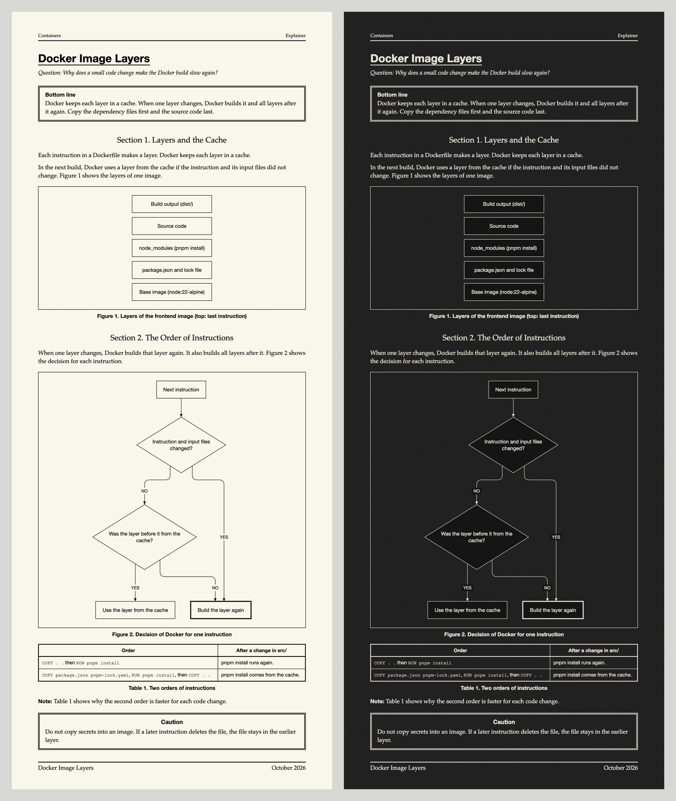
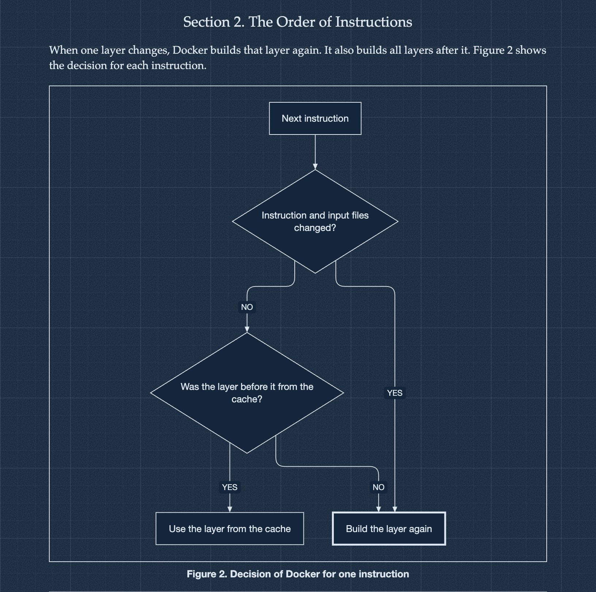
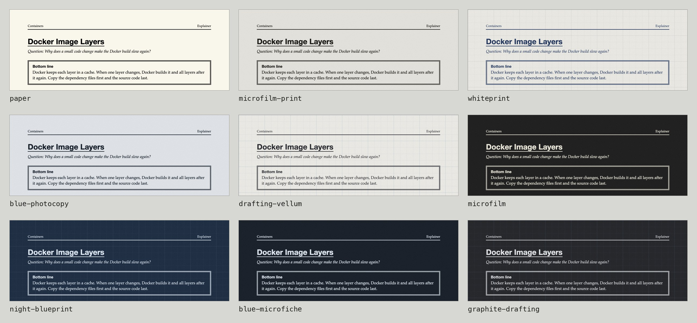

# Writing field manuals



Writes technical explanations as one HTML page that looks like a 1980s or 1990s field manual: numbered figures and tables, Caution and Note boxes, Mermaid diagrams, and light or dark vintage themes. Diagrams are rendered by [Pele](https://github.com/obsidianmd/pele), which comes bundled with the skill.

A build script checks the structure, the words and the diagrams. It tells the agent how to fix each error, so the page comes out clean.

For instance, ask: "Explain the N+1 query problem as a lesson. Use the microfilm theme."

It can write six types of documents: explainer, lesson, decision record, comparison, procedure, and incident report.

## Diagrams

The agent writes Mermaid text. Pele draws it in the style of the page.



## Themes

Five light themes and four dark themes. The page also has a theme select, so the reader can switch.



## Build checks

The build does not make a page with errors. Each error has a line number and a fix:

```
doc.src.html:9  E401  Em dash or en dash found.
        Fix: Use a comma, a colon or a period. For a range, write "to".
doc.src.html:26  E204  Reference {{fig:decsion}}: no figure has id "decsion".
        Fix: Add id="decsion" to the figure or table, or fix the name.

NOT BUILT: 2 error(s), 0 warning(s). Fix the errors, then build again.
```

## Install

```bash
npx skills add ahm3tj4f/skills --skill writing-field-manuals --skill asd-ste100
```

The text is written in Simplified Technical English with the `asd-ste100` skill. Without it, the skill uses its own short rules.

## Requirements

- Node.js 20 or later
- [agent-browser](https://github.com/vercel-labs/agent-browser) CLI (optional, for the render check and screenshots)

## Credits

Diagrams are rendered by Pele by kepano (MIT). See [scripts/vendor/PELE-LICENSE](scripts/vendor/PELE-LICENSE).

## License

[MIT](../../LICENSE)
